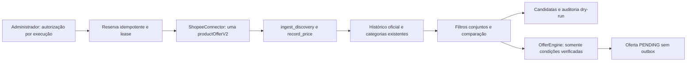

# Fase 4.8 — coleta Shopee controlada, histórico e candidatas

Esta entrega integra o contrato Shopee já validado ao histórico e aos filtros locais. **Nenhuma nova consulta comercial foi autorizada ou executada.** A consulta oficial anterior comprovou somente a leitura pontual de `productOfferV2`; os novos fluxos foram exercitados com `httpx.MockTransport` e bancos isolados.

## Arquitetura



Migração aditiva `0008_shopee_collection`: tabelas `shopee_collection_runs` e `shopee_collection_candidates`, com vínculos ao produto/histórico e restrição de uma tentativa reservada. O downgrade recusa perda de registros. As migrações anteriores permanecem inalteradas.

Reutilizados `ShopeeConnector`, `ConnectorRegistry`, leases, ingestão, histórico, aritmética de comparação, `CategoryService`, `OfferEngine` e `MonitoringRuntime/APScheduler`. O matching por frase/produto foi extraído para helper compartilhado; o comportamento padrão da Fase 4.7 continua preservado. O contrato normalizado passou a transportar também os limites de preço efetivamente retornados, sem escolher uma variante arbitrária.

## Dados e comparabilidade

Identidade persistida: plataforma Shopee, `shopId:itemId`, variante, nome integral, URL canônica e origem oficial. Histórico registra Decimal, horário do provedor, fingerprint, imagem, categorias positivas e preços mínimo/máximo. Zero de categoria continua sem classificação. Correções manuais de categorias e links já cadastrados não são substituídos.

| Campo de avaliação | Significado | Pode gerar desconto/oferta? |
|---|---|---|
| `reported_change` | Variação informativa de preços reportados, com mesma identidade, fonte, moeda, domínio real/simulado, disponibilidade, acesso e tipo de intervalo | Não, isoladamente |
| `verified_change` | Comparação existente exige disponibilidade e acesso público comprovados, preço válido, moeda BRL, contexto comparável e atualidade | Somente queda verificada pode seguir para avaliação |
| Comissão | Evidência comercial de afiliado, preservada separadamente | Nunca é desconto ao consumidor |

A primeira observação é referência `INITIAL`, não queda. Observações posteriores registram aumento, estabilidade ou redução informativa com Decimal e percentual; sem condições verificadas, permanecem `UNVERIFIED`. Falta de preço ou intervalo de variantes não resolvido não produz preço escolhido nem desconto. História simulada não é baseline oficial. Cupom, estoque, preço antigo anunciado, parcelamento e condições públicas não são inventados.

Estados de candidata: `INITIAL`, `FILTERED`, `UNVERIFIED`, `MANUAL_REVIEW` e `EXPIRED`. Não há estado de envio nem uso de mensagens técnicas. Mesmo numa hipótese futura com queda verificada, o motor é chamado sem enqueue e a oferta fica `PENDING`. Link próprio verificado e aprovação do conteúdo/destino continuam obrigatórios para qualquer futura publicação; esta entrega não concede essa autorização.

## Filtros

- Categorias ativas selecionadas **E** produto específico ou termo normalizado **E** limiares opcionais.
- `max_price`: somente preço conhecido dentro do limite.
- `min_discount`: exclusivamente percentual de queda **verificada**; variação informativa/comissão não satisfaz o filtro.
- Termos com intenção de console, como PlayStation 5/PS5, exigem evidência positiva de console no nome e rejeitam cabos, capas, cases, controles, suportes e outros acessórios conhecidos. Títulos ambíguos ficam excluídos para revisão; não se presumem sinônimos ou identidade específica.
- Consulta por palavra-chave não adiciona o termo ao nome nem às categorias. Games é categoria ampla e não equivale a Console. IDs escolhidos manualmente não dispensam categorias e demais controles.

## API administrativa local

Todas as rotas usam autenticação `X-API-Key` e a proteção local existente:

| Método e caminho | Função |
|---|---|
| `POST /api/v1/shopee-collection/runs` | Uma leitura real explicitamente autorizada por execução; sem modo offline exposto |
| `GET /api/v1/shopee-collection/runs` | Até 100 execuções, modo, resultado e erro sanitizado |
| `GET /api/v1/shopee-collection/candidates` | Até 100 candidatas e motivos |
| `POST /api/v1/shopee-collection/candidates/{id}/revalidate` | Revalidação local, sem nova consulta; conserva avaliação inicial e acrescenta evento de auditoria |
| `POST /api/v1/shopee-collection/schedule/prepare` | Prepara job pausado no runtime existente, sem iniciar threads ou polling |

Formato ilustrativo, **bloqueado por padrão**:

```json
{
  "request_id": "00000000-0000-4000-8000-000000000048",
  "query": "PlayStation 5",
  "limit": 1,
  "actor": "responsavel",
  "confirmed_real_read": false,
  "authorization": null,
  "filters": {
    "categories": ["games"],
    "terms": ["PlayStation 5"],
    "product_ids": [],
    "max_price": null,
    "min_discount": null
  }
}
```

Não enviar esse exemplo como consulta real nesta fase. Uma execução futura precisa de escopo apresentado ao responsável, autorização explícita nova, referência registrada, `confirmed_real_read=true` e UUID próprio. Não basta ter credenciais ou ter autorizado uma consulta anterior. O texto da autorização não deve conter segredos.

## Limites, concorrência e falhas

Uma página, de um a cinco produtos, **um POST no máximo**, sem retries, redirects, descoberta adicional, mutations ou geração de links. `hasNextPage` é registrado e não seguido. A reserva é persistida antes do HTTP; UUID repetido retorna o resultado/reserva e não refaz a operação. UUID com outro conteúdo é recusado. Snapshot repetido com mesma fonte, fingerprint e horário não duplica histórico; uma nova observação no tempo é preservada, mesmo com preço igual.

Lease compartilhado de coleta e fencing antes da transação de ingestão impedem trabalhadores concorrentes de persistir o mesmo lote. Nenhuma ingestão parcial é confirmada em falha. No caminho real, o registry mantém quota/bloqueio por credencial e intervalo conservador local de **900 segundos**, inclusive entre novas instâncias. Esse intervalo é limite local, **não quota oficial comprovada**. Rate limit/5xx não disparam nova tentativa. Recusa de autorização/GraphQL bloqueia a conta para revisão; timeout/falha de rede ou perda de lease registra `UNCERTAIN`. Banco indisponível pode deixar a reserva anterior pendente, que nunca é retomada automaticamente.

O job preparado usa o APScheduler já existente, `next_run_time=None`, `max_instances=1` e coalescência. Sua função retorna bloqueio por ausência de autorização comercial contínua mesmo se acionada diretamente. Não existe rota de ativação/resume comercial nesta entrega. O planejamento em memória precisa ser preparado novamente após reiniciar a aplicação; specs e resultados das coletas ficam persistidos para revisão.

## Evidência offline

[DEMONSTRACAO_FASE_4_8.json](DEMONSTRACAO_FASE_4_8.json) registra execução real do código com MockTransport e SQLite novo e isolado, preservado em `.runtime`:

1. Replay do nó observado anteriormente: cabo HDMI, preço informado `59.00`; referência inicial, nenhuma queda/oferta.
2. **Cenário hipotético explícito**, não preço de mercado: `59.00 → 55.00`, redução informativa de `-6.78%`, candidata `UNVERIFIED`, nenhum desconto comercial validado.
3. Mesmo cabo submetido ao filtro PlayStation 5: `FILTERED`, sem virar console.

Resultado: **1 produto, 2 observações, 3 avaliações de candidatas, 0 ofertas, 0 itens de outbox, 3 chamadas mockadas e 0 consultas comerciais reais/Telegram**. Repetir o UUID inicial acrescentou zero chamadas. O preço `55.00` é fictício e foi usado exclusivamente nesse banco isolado; nada foi inserido no banco principal.

Reprodução das verificações offline:

```powershell
.\.venv\Scripts\python.exe -m pytest -q tests/test_shopee_collection.py
```

O replay recusa banco principal/public no PostgreSQL e exige schema UUID em `ofertas_bot_test`, ou SQLite de testes, além de `MockTransport` no destino oficial. Não importa preços fictícios para produção. As integrações PostgreSQL usam os fixtures UUID existentes; nenhum banco/schema preexistente é removido.

## Estado e próximos requisitos

Todas as cinco flags permanentes do briefing permanecem `false`; grupo Viana Ofertas pausado e monitoramento principal desativado. `.env`, credenciais, nove categorias e dados anteriores preservados. Nenhuma publicação, consulta comercial adicional, commit ou avanço às Fases 5/6.

Comprovado: uma leitura oficial anterior de `productOfferV2`, normalização do nó observado e pipeline offline/isolado. Pendente: nova validação real com autorização específica; quotas e políticas aplicáveis à conta; comprovação de estoque, variantes e condições de preço; autorização e verificação de links próprios antes de qualquer geração; política e autorização de operação contínua e publicação. Aprovação de leitura não autoriza publicação.

**1.183 testes aprovados**, incluindo **38 PostgreSQL reais** em schemas UUID isolados de `ofertas_bot_test`; zero falhas e zero ignorados. Os 1.129 anteriores foram preservados e 54 novos acrescentados (46 offline e oito PostgreSQL). Há 17 avisos de depreciação de dependências, sem falhas. Ruff e formatação de 140 arquivos passaram; Alembic `upgrade head/current/check` passou em `0008_shopee_collection`, sem drift. A comparação por fingerprints confirmou preservação de todas as tabelas anteriores. `.env` idêntico antes/depois, nove categorias ativas, grupo pausado, monitoramento principal desativado, cinco flags `false` e novas tabelas principais vazias. Ver [resumo sanitizado da validação](VALIDACAO_FASE_4_8.json).
